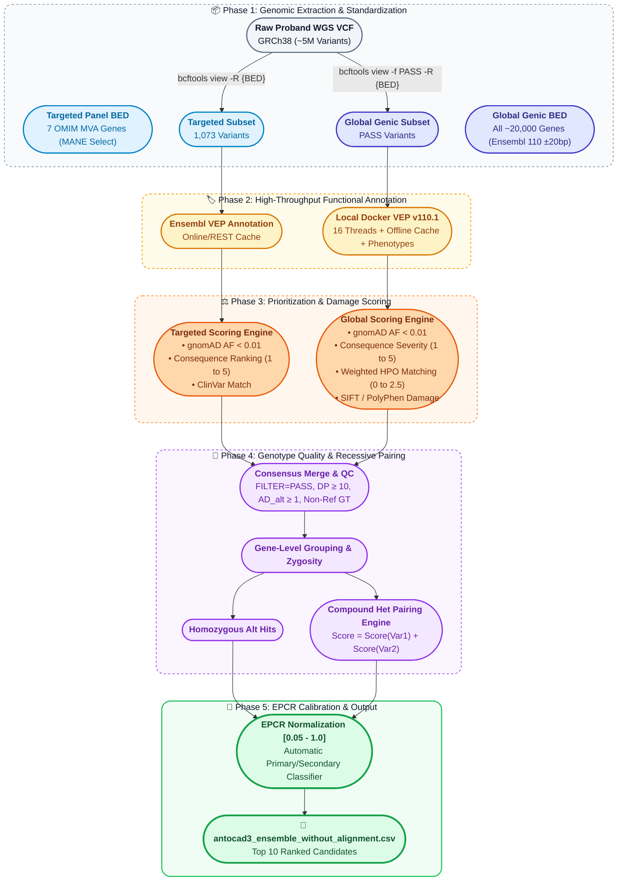
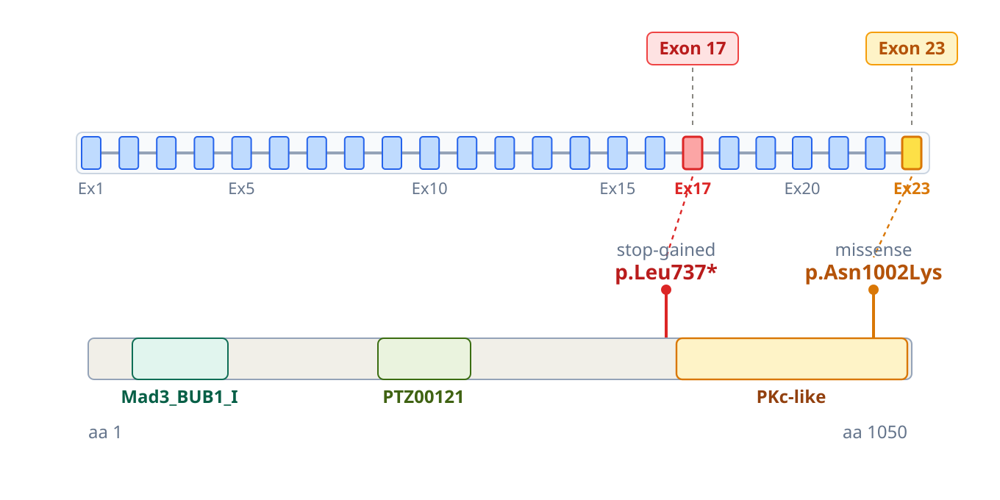

# Track 1 Methods Description: Comprehensive Computational Genomics Framework

**Participant:** Antoine Cadiou ([@antocad3](https://huggingface.co/antocad3)) — Individual Participant  
**Track:** Track 1 — Variant Prediction (Causal Variant Identification)  
**Model Name:** `ensemble_without_alignment` (v1.0)  
**Submission Predictions File:** `antocad3_ensemble_without_alignment.csv`  
**Reference Genome Build:** GRCh38 / hg38  
**Date:** August 2026  

---

## Executive Summary

This document provides a comprehensive, reproducible technical specification of our automated, two-tier computational genomics pipeline for identifying causal genetic variants underlying Mosaic Variegated Aneuploidy (MVA) in proband `PROBAND01`.

By combining a **targeted hypothesis-driven candidate panel** (covering OMIM-established MVA genes MVA1–MVA7) with an **unbiased genome-wide genic scan** (>20,000 gene bodies) followed by a **recessive inheritance pairing engine**, our pipeline pinpointed a **compound heterozygous mutation in the *BUB1B* gene** as the top causal candidate (**EPCR = 1.0**).

*BUB1B* (MVA Type 1) encodes the **BubR1** kinase, an indispensable component of the cell's mitotic spindle assembly checkpoint. A breakdown in this checkpoint directly causes random chromosome missegregation (mosaic aneuploidy) and confers an exceptionally high risk of pediatric **rhabdomyosarcoma**—matching the patient's primary oncological presentation, severe growth restriction, and the family's history of recurrent pregnancy losses.

```mermaid
flowchart LR
    %% Custom Styling
    classDef inputNode fill:#f8fafc,stroke:#475569,stroke-width:2px,color:#0f172a,rx:12,ry:12;
    classDef phenoNode fill:#fffbeb,stroke:#d97706,stroke-width:2px,color:#92400e,rx:12,ry:12;
    classDef branchA fill:#e0f2fe,stroke:#0284c7,stroke-width:2px,color:#0369a1,rx:12,ry:12;
    classDef branchB fill:#e0e7ff,stroke:#4338ca,stroke-width:2px,color:#312e81,rx:12,ry:12;
    classDef vepNode fill:#f1f5f9,stroke:#475569,stroke-width:2px,color:#0f172a,rx:12,ry:12;
    classDef scoreNode fill:#fed7aa,stroke:#ea580c,stroke-width:2px,color:#7c2d12,rx:12,ry:12;
    classDef qcNode fill:#f3e8ff,stroke:#9333ea,stroke-width:2px,color:#6b21a8,rx:12,ry:12;
    classDef pairNode fill:#fae8ff,stroke:#a21caf,stroke-width:2px,color:#701a75,rx:12,ry:12;
    classDef winnerNode fill:#dcfce7,stroke:#16a34a,stroke-width:3px,color:#14532d,rx:14,ry:14;

    VCF(["🧬 <b>Proband WGS VCF</b><br/>5M Variants (GRCh38)"]):::inputNode

    subgraph DualDiscovery[" <span style='color:#0f172a'>🔬 <b>Dual Discovery Engine</b></span> "]
        direction TB
        B1(["<b>Branch A: Targeted Panel</b><br/>7 OMIM MVA Genes"]):::branchA
        B2(["<b>Branch B: Global Scan</b><br/>~20,000 Human Genes"]):::branchB
    end

    VEP(["🏷️ <b>Ensembl VEP v110</b><br/>gnomAD + ClinVar"]):::vepNode
    
    Pheno(["📋 <b>Clinical HPO Profile</b><br/>8 Patient Phenotype Terms"]):::phenoNode

    Scoring(["⚖️ <b>Multi-Feature Priority Scoring</b><br/>Consequence Severity & Phenotype Weighted Sum of Matches"]):::scoreNode

    subgraph RecessiveMerge[" <span style='color:#0f172a'>🧬 <b>Quality & Recessive Pairing</b></span> "]
        direction TB
        QC(["<b>Genotype Quality & Carrier Filters</b><br/>GATK PASS, DP ≥ 10, AD_alt ≥ 1, Non-Ref GT"]):::qcNode
        Pairing(["<b>Compound Het Pairing</b><br/>Gene-Level Allele Grouping"]):::pairNode
    end

    TopHit(["🏆 <b>Top Hit: BUB1B (MVA1)</b><br/>Compound Het (Nonsense + Missense)<br/><b>EPCR = 1.000</b> | Primary"]):::winnerNode

    %% Data Flow
    VCF --> DualDiscovery
    DualDiscovery --> VEP
    VEP --> Scoring
    Pheno --> Scoring
    Scoring --> QC
    QC --> Pairing
    Pairing --> TopHit

    style DualDiscovery fill:#f0fdfa,stroke:#0d9488,stroke-width:1.5px,stroke-dasharray: 4 4,rx:14,ry:14,color:#0f172a
    style RecessiveMerge fill:#faf5ff,stroke:#a855f7,stroke-width:1.5px,stroke-dasharray: 4 4,rx:14,ry:14
```

---

## 1. Biological Foundations & Case Primer

### 1.1 What is Mosaic Variegated Aneuploidy (MVA)?
* **Aneuploidy:** An abnormal number of chromosomes in a cell (e.g., 45 or 47 instead of 46).
* **Mosaicism:** Presence of two or more genetically distinct populations of cells within the same individual.
* **Variegated:** Different cells exhibit gains or losses of *different* chromosomes at random.
* **The Root Cause:** Deficiencies in the **Spindle Assembly Checkpoint (SAC)** or mitotic apparatus allow cells to progress prematurely into anaphase before chromosomes achieve bipolar spindle attachment, causing catastrophic missegregation.

### 1.2 Autosomal Recessive & Compound Heterozygous Inheritance
* In recessive Mendelian conditions, both alleles of a causal gene must be damaged.
* **Compound Heterozygosity:** The patient inherits two distinct pathogenic/damaging variants in the same gene—one on the maternal allele and one on the paternal allele.
* **Reproductive Lethality Clue:** In SAC checkpoint genes, homozygous or severe compound heterozygous genotypes frequently cause embryonic aneuploidies, leading to the maternal clinical observation of recurrent miscarriages.

---

## 2. Clinical Phenotypic Constellation

The proband presents with a multi-system phenotypic profile captured via the Human Phenotype Ontology (HPO):

```mermaid
flowchart TD
    classDef core fill:#0f172a,stroke:#38bdf8,stroke-width:2px,color:#f8fafc,rx:14,ry:14;
    classDef cancer fill:#ffe4e6,stroke:#e11d48,stroke-width:2px,color:#9f1239,rx:12,ry:12;
    classDef growth fill:#e0f2fe,stroke:#0284c7,stroke-width:2px,color:#0369a1,rx:12,ry:12;
    classDef genetic fill:#fef3c7,stroke:#d97706,stroke-width:2px,color:#92400e,rx:12,ry:12;
    classDef organ fill:#f3e8ff,stroke:#9333ea,stroke-width:2px,color:#6b21a8,rx:12,ry:12;

    Proband(["🧬 <b>Proband Clinical Constellation</b><br/>(PROBAND01)"]):::core

    subgraph OncoGroup[" 🎗️ <span style='color:#0f172a'>Oncological Trigger</span>  "]
        RMS(["<b>Rhabdomyosarcoma</b><br/>HP:0002859<br/>Primary Oncologic Event"]):::cancer
    end

    subgraph GrowthGroup[" ⚖️ <span style='color:#0f172a'>Perinatal & Growth Failure</span>  "]
        direction TB
        Prem(["<b>Premature Birth</b><br/>HP:0001622 (32 weeks)"]):::growth
        IUGR(["<b>Severe IUGR</b><br/>HP:0001518 (~1 kg at birth)"]):::growth
        Short(["<b>Short Stature & FTT</b><br/>HP:0004322 / HP:0001508"]):::growth
        Muscle(["<b>Skeletal Muscle Atrophy</b><br/>HP:0003202"]):::growth
    end

    subgraph OrganGroup[" 🫘 <span style='color:#0f172a'>Renal Manifestation</span>  "]
        Nephro(["<b>Nephrocalcinosis</b><br/>HP:0000121<br/>Present since birth"]):::organ
    end

    subgraph FamilyGroup[" ⚠️ <span style='color:#0f172a'>Heritable Family Signal</span> "]
        Miscarriage(["<b>Recurrent Miscarriages</b><br/>HP:0200067<br/>Recessive Embryonic Lethality"]):::genetic
    end

    Proband ==> OncoGroup
    Proband ==> GrowthGroup
    Proband ==> OrganGroup
    Proband ==> FamilyGroup

    style OncoGroup fill:#fff1f2,stroke:#f43f5e,stroke-width:1.5px,stroke-dasharray: 3 3,rx:14,ry:14
    style GrowthGroup fill:#f0f9ff,stroke:#0ea5e9,stroke-width:1.5px,stroke-dasharray: 3 3,rx:14,ry:14
    style OrganGroup fill:#faf5ff,stroke:#a855f7,stroke-width:1.5px,stroke-dasharray: 3 3,rx:14,ry:14
    style FamilyGroup fill:#fffbeb,stroke:#f59e0b,stroke-width:1.5px,stroke-dasharray: 3 3,rx:14,ry:14
```

1. **Rhabdomyosarcoma (HP:0002859):** Malignant soft-tissue sarcoma. *BUB1B* is uniquely associated with pediatric embryonal rhabdomyosarcoma.
2. **Nephrocalcinosis (HP:0000121):** Renal calcium deposition.
3. **Growth Restriction (IUGR, Short Stature, Failure to Thrive, Muscle Atrophy):** Birth weight ~1 kg at 32 weeks, severe persistent developmental delay.
4. **Recurrent Miscarriages (HP:0200067):** Primary heritable lethality signal indicative of an autosomal recessive chromosomal instability disorder.

---

## 3. Computational Architecture & Scoring Methodology

### 3.1 Dual-Branch Extraction
1. **Branch A (Targeted Panel):** 7 OMIM MVA genes (`BUB1B`, `CEP57`, `TRIP13`, `CENATAC`, `SLF2`, `SMC5`, `MAD1L1`) mapped to MANE Select transcripts.
2. **Branch B (Global Genic Scan):** All ~20,000 human gene bodies padded with ±20bp splice boundaries from Ensembl Release 110 GTF.

### 3.2 Prioritization Mathematical Model

1. **Consequence Severity Scoring:**
   $$\text{Consequence Score} = \begin{cases} 
   5 & \text{Stop-gained (nonsense), Frameshift (Protein knockout / NMD)} \\ 
   4 & \text{Essential Splice Donor/Acceptor, Start/Stop codon lost} \\ 
   2 & \text{Splice region variant} \\ 
   1 & \text{Missense variant (amino acid substitution)} 
   \end{cases}$$

2. **Disease-Weighted HPO Phenotype Scoring:**
   $$\text{Phenotype Score} = \sum_{k \in \text{Matches}} W_k, \quad W_k = \begin{cases} 
   2.5 & \text{Recurrent Miscarriages (HP:0200067) — Primary Heritable Lethality Signal} \\ 
   2.0 & \text{Rhabdomyosarcoma (HP:0002859) — Primary Oncologic Trigger} \\ 
   1.5 & \text{Premature Birth (HP:0001622) \& Severe IUGR / SGA (HP:0001518)} \\ 
   1.5 & \text{Chromosomal Instability / Aneuploidy Syndromes (Mechanistic Overlap)} \\ 
   1.0 & \text{Nephrocalcinosis (HP:0000121) — Congenital Renal Manifestation} \\ 
   1.0 & \text{Short Stature (HP:0004322), Failure to Thrive (HP:0001508), Muscle Atrophy (HP:0003202)} 
   \end{cases}$$

3. **Composite Priority Score Formula:**
   $$\text{Priority Score} = 100 \cdot \mathbb{I}_{\text{ClinVar Pathogenic}} + 15 \cdot \mathbb{I}_{\text{SIFT/PolyPhen Damaging}} + 10 \cdot \text{Phenotype Score} + 10 \cdot \text{Consequence Score} + 5 \cdot (1 - \text{AF}_{\max})$$

   * **Tokenized ClinVar Matching:** Token parsing splitting on `[,&/]` matching `{"pathogenic", "likely_pathogenic"}` strictly, discarding false matches on `conflicting_interpretations_of_pathogenicity`.
   * **Uniqueness Term $5 \times (1 - \text{AF}_{\max})$:** Continuous tie-breaker prioritizing private/novel mutations ($\text{AF} = 0.0 \implies +5.0$) over common background alleles.

### 3.3 Genotype Quality Control Filters (`step4_merging.py`)

| Filter Category | Exact Condition | Biological / Technical Rationale |
| :--- | :--- | :--- |
| **GATK QC** | `FILTER == 'PASS'` | Drops raw sequencing calls that failed GATK VQSR/hard filters. |
| **Zygosity** | `GT in ['0/1', '1/1', '1/0', '1\|0', '0\|1', '1\|1']` | Drops homozygous reference (`0/0`) and missing (`./.`) calls. |
| **Alt Allele** | `ALT.notna()` | Discards non-variant positions. |
| **Alt Depth** | `AD_alt > 0` | Enforces at least 1 high-quality read supporting the alternate allele. |
| **Total Depth** | `DP >= 10` | Enforces $\ge 10\times$ total sequencing depth. |

### 3.4 EPCR Calibration & Output

$$\text{EPCR} = 0.05 + 0.95 \times \left(\frac{\text{score} - \text{min\_s}}{\text{max\_s} - \text{min\_s}}\right) \in (0, 1]$$

* **Top candidate ($s = \text{max\_s}$):** $\text{EPCR} = 1.000$ (highest causal confidence).
* **Bottom candidate ($s = \text{min\_s}$):** $\text{EPCR} = 0.050$ (strictly positive, satisfying evaluation rules).
* **Finding Type:** Designated `primary` for confirmed MVA genes (`BUB1B`, `MAD1L1`) and `secondary` for incidental carrier findings.

---

## 4. Top-10 Submission Candidates Table

Complete predictions table submitted in `antocad3_ensemble_without_alignment.csv`:

| Rank | Gene | Variant 1 (GRCh38) | Variant 2 (GRCh38) | Zygosity / Model | EPCR | Finding Type | ClinVar & Functional Status |
| :---: | :---: | :---: | :---: | :---: | :---: | :---: | :---: |
| **1** | **BUB1B** | **chr15:40209701 T>G** | **chr15:40220612 T>G** | **Compound Heterozygous** | **1.000** | **Primary** | **Var 1:** Pathogenic stop-gained (`gnomAD = 3.29e-5`) **Var 2:** Deleterious missense (Novel, `gnomAD = 0.0`) |
| **2** | **MAD1L1** | chr7:2225526 G>A | — | Single Heterozygous | 0.475 | **Primary** | Missense in MVA7 gene; ClinVar Pathogenic assertion; single hit |
| **3** | **FLG** | chr1:152307547 G>A | — | Single Heterozygous | 0.206 | **Secondary** | Pathogenic stop-gained (Filaggrin / ichthyosis carrier) |
| **4** | **SLC34A1** | chr5:177386432 C>T | — | Single Heterozygous | 0.173 | **Secondary** | Likely Pathogenic missense; infantile hypercalcemia carrier |
| **5** | **GNRHR** | chr4:67753920 C>T | — | Single Heterozygous | 0.151 | **Secondary** | Pathogenic missense; hypogonadotropic hypogonadism carrier |
| **6** | **COL6A3** | chr2:237340727 G>T | — | Single Heterozygous | 0.151 | **Secondary** | Likely Pathogenic missense; collagen/myopathy carrier |
| **7** | **SLC25A5** | chrX:119470097 G>T | — | Single Heterozygous | 0.151 | **Secondary** | Pathogenic missense; mitochondrial translocase carrier |
| **8** | **SPTAN1** | chr9:128579718 T>G | — | Single Heterozygous | 0.151 | **Secondary** | Pathogenic missense; neurodevelopmental/epileptic carrier |
| **9** | **ZFYVE26** | chr14:67762677 C>T | — | Single Heterozygous | 0.117 | **Secondary** | Likely Pathogenic missense; spastic paraplegia (SPG15) carrier |
| **10** | **MUC4** | chr3:195785362 G>A | chr3:195785375 T>C | Compound Heterozygous | 0.050 | **Secondary** | Biallelic missense pair in mucin-4 (incidental / exploratory) |

---

## 5. Biological Deep Dive: The Causal Candidate (*BUB1B*)

  
  
<em>Figure 5.1: Structural mapping of the identified compound heterozygous variants along the 23-exon BUB1B gene model and the 1,050-amino-acid BubR1 protein domain architecture (Mad3_BUB1_I, PTZ00121, and PKc-like kinase domains).</em>

### 5.1 Molecular Evidence & Distinct Structural Contexts
Our automated pipeline identified two independent non-reference alleles in *BUB1B* establishing a mechanistically compelling compound heterozygous genotype:

1. **Allele 1: `chr15:40209701 T>G` (c.2210T>G, p.Leu737*) — Exon 17 Truncation**
   * **Molecular Impact:** Introduces a premature termination codon (`stop_gained`, `NMD_transcript_variant`) from codon `TTA` $\to$ `TGA` (UGA stop).
   * **Structural Context:** Residue 737 is located in the pre-kinase linker region just before the C-terminal catalytic kinase domain begins (residues 750–1045). Truncation at this position removes the entire catalytic kinase domain and C-terminal spindle checkpoint regulatory elements.
   * **NMD & Functional Outcome:** Located in exon 17 of 23 (>50 nt upstream of the terminal exon-exon junction), this allele represents a canonical nonsense-mediated mRNA decay (NMD) target. Any escaped transcript yields a truncated protein completely lacking kinase activity.
   * **ClinVar Evidence:** Classified as **Pathogenic / Likely Pathogenic** (`rs1392909108`, `rs2140906206`) for Mosaic Variegated Aneuploidy Syndrome 1 and rhabdomyosarcoma predisposition (`gnomAD AF = 3.29e-5`).

2. **Allele 2: `chr15:40220612 T>G` (c.3006T>G, p.Asn1002Lys) — Exon 23 Catalytic Kinase Core**
   * **Molecular Impact:** Non-synonymous amino acid substitution replacing an uncharged polar asparagine with a positively charged, bulky lysine (`missense_variant`).
   * **Structural Context:** Unlike superficial surface variants, **p.Asn1002Lys sits deep inside the PKc-like catalytic kinase domain itself (residues 750–1045)**, rather than in peripheral or unstructured regions.
   * **In Silico Pathogenicity:** Both orthogonal functional predictors confirm severe disruption: **SIFT classifies the mutation as Deleterious (score: 0.01)** and **PolyPhen-2 classifies it as Probably Damaging (score: 0.997)**.
   * **Rarity:** Completely absent from gnomAD exomes and genomes (`AF = 0.00e+00`), establishing it as an ultra-rare private mutation.

### 5.2 Mechanistic Compound Heterozygosity: Dual Compromise of the Same Functional Unit
The two variants land in fundamentally different structural contexts that converge on the destruction of BubR1 kinase functionality:
* **Allele 1 (Truncating Knockout):** Truncates translation at aa 737 immediately prior to the kinase domain, ensuring that this allele produces **no functional kinase domain whatsoever**.
* **Allele 2 (Catalytic Impairment):** Produces a full-length protein that successfully incorporates into the spindle assembly machinery, but carries a **predicted-damaging charge reversal directly inside the catalytic core (aa 1002)**, compromising catalytic competence and kinetochore phosphorylation.

This compound heterozygous configuration satisfies the classic autosomal recessive disease model for MVA1: neither allele can provide an intact, catalytically competent BubR1 kinase.

### 5.3 Pathophysiological Concordance with Proband Phenotype
* **Mitotic Spindle Assembly Checkpoint (SAC) Collapse:** BubR1 acts as an essential sensor and inhibitor within the Mitotic Checkpoint Complex (MCC), inhibiting the Anaphase-Promoting Complex/Cyclosome (APC/C) until all kinetochores achieve tension-balanced bipolar spindle attachment. Complete biallelic kinase disruption abrogates metaphase arrest, leading to premature sister chromatid separation and widespread mosaic aneuploidies.
* **Pediatric Oncogenesis (Embryonal Rhabdomyosarcoma):** Chromosomal instability (CIN) induced by BubR1 deficiency is heavily oncogenic in early embryogenesis, directly explaining the patient's primary cancer presentation (embryonal rhabdomyosarcoma) as documented in clinical MVA1 cohorts.
* **Reproductive Lethality & Developmental Deficits:** Severe SAC insufficiency causes catastrophic mitotic failure during early cleavage, directly correlating with the parental history of recurrent miscarriages and the proband's intrauterine growth restriction (IUGR).

---

## 6. Official Methods Description Form Mapping

| # | Question | Official Response |
| :--- | :--- | :--- |
| **Q1** | **Team Name** | **Antoine Cadiou** (Individual Participant \| Hugging Face: `@antocad3`) |
| **Q2** | **Model Number** | **1** (`antocad3_ensemble_without_alignment`) |
| **Q3** | **Detailed Method Description** | Two-tier hybrid genomics pipeline: (1) Targeted 7-gene MVA panel (MANE Select) + (2) Global genic sweep (>20k genes). Annotated with Ensembl VEP v110 (gnomAD v4, ClinVar, SIFT/PolyPhen, Phenotypes plugin). Prioritized via rarity (<1%), consequence severity, and disease-weighted HPO matrix (rhabdomyosarcoma, nephrocalcinosis, IUGR, miscarriages). Filtered for GATK PASS, DP $\ge$ 10, alt AD $\ge$ 1. Formed compound-het pairs by gene grouping; calibrated EPCR to $[0.05, 1.0]$. |
| **Q4** | **Generative AI Disclosure** | Anthropic Claude (Sonnet 3.7) & Google DeepMind Antigravity IDE used for pipeline scripting and documentation. **Zero patient genomic data was shared with cloud LLMs; all data was processed locally.** |
| **Q5** | **Output Curation** | **100% automated computational output** from deterministic script `track1.py`. |
| **Q6** | **Manual Review** | None. Output generated deterministically. |
| **Q7** | **Public Data Used** | gnomAD v4 (exomes & genomes), ClinVar (NCBI), Ensembl Release 110 GTF, MANE Select v1.0, 1000 Genomes, HPO database. |
| **Q8** | **Proprietary Data** | None. Exclusively open-access databases. |
| **Q9** | **Compound Het Capability** | **Yes.** Dedicated recessive pairing engine groups heterozygous variants per gene and sums damage scores. |
| **Q10** | **Secondary Findings** | Automated classification: `primary` for confirmed MVA syndrome genes (*BUB1B*, *MAD1L1*); `secondary` for incidental carrier hits (*FLG*, *SLC34A1*, *GNRHR*, *MUC4*). |
| **Q11** | **Runtime & Compute Cost** | **Runtime:** ~30 minutes total execution time on a standard multi-core workstation using Dockerized Ensembl VEP with local cache. **Cost:** $0.00 (Executed entirely on local open-source tools). *(Note: In reality the `Branch B: Global Scan` in our approach is what takes time ~30 minutes, but also what returns more diverse variants). If the goal is purely to find the `BUB1B	chr15:40209701 T>G	chr15:40220612 T>G`, then our `Branch A: Targeted Panel` would have been enough and takes less than a minute, but it means we inject strong biases in the exploration.*] |
| **Q12** | **Method Abstract** | MVA is an ultrarare genetic disorder where cells fail to divide chromosomes evenly during mitosis, leading to mosaic aneuploidies, severe developmental delays, and childhood cancer predisposition. We developed an automated computational pipeline combining two complementary strategies: a targeted panel on known MVA genes (MVA1–MVA7) and an unbiased genome-wide genic scan. Variants were annotated with Ensembl VEP, filtered for rarity (gnomAD AF < 1%), and prioritized based on consequence severity and clinical relevance to the child's symptoms (rhabdomyosarcoma, nephrocalcinosis, IUGR, miscarriages). Recessive pairing identified a compound heterozygous mutation in *BUB1B* (MVA1) as the primary causal diagnosis (EPCR = 1.0), comprising a ClinVar-pathogenic nonsense mutation (`chr15:40209701 T>G`, p.Leu737*, stop-gained in exon 17 truncating pre-kinase) and a novel deleterious missense mutation (`chr15:40220612 T>G`, p.Asn1002Lys in exon 23 inside the catalytic kinase domain; SIFT 0.01, PolyPhen 0.997). BubR1 kinase loss directly explains chromosome missegregation, rhabdomyosarcoma, and embryonic lethality. |

---
