# Methods Description & Brief Report — Track 1 (Variant Prediction)

**Participant:** Antoine Cadiou ([@antocad3](https://huggingface.co/antocad3)) — Individual Participant  
**Track:** Track 1 — Variant Prediction (Causal Variant Identification)  
**Submission File:** `antocad3_ensemble_without_alignment.csv`  
**Model Name:** `ensemble_without_alignment` (Model 1 of 1)  
**Proband ID:** `PROBAND01`
**Reference Genome Build:** GRCh38 / hg38  

---

### Question 1: Team Name
**Antoine Cadiou** (Individual Participant | Hugging Face: [@antocad3](https://huggingface.co/antocad3))

---

### Question 2: Model Number & Identifier
**Model 1** (`antocad3_ensemble_without_alignment`)

---

### Question 3: Detailed Description of Model / Approach

> *(Note: A comprehensive technical specification, including full mathematical scoring derivations, QC filter tables, and biological deep-dives, is provided in `antocad3_methods_description.md` in the GitHub repository).*

We implemented a two-tier hybrid computational genomics pipeline that unifies hypothesis-driven targeted candidate panel interrogation with an unbiased genome-wide genic sweep:

```mermaid
flowchart LR
    %% Custom Styling
    classDef inputNode fill:#f8fafc,stroke:#475569,stroke-width:2px,color:#0f172a,rx:12,ry:12;
    classDef phenoNode fill:#fffbeb,stroke:#d97706,stroke-width:2px,color:#92400e,rx:12,ry:12;
    classDef branchA fill:#e0f2fe,stroke:#0284c7,stroke-width:2px,color:#0369a1,rx:12,ry:12;
    classDef branchB fill:#e0e7ff,stroke:#4338ca,stroke-width:2px,color:#312e81,rx:12,ry:12;
    classDef vepNode fill:#f1f5f9,stroke:#475569,stroke-width:2px,color:#0f172a,rx:12,ry:12;
    classDef scoreNode fill:#fed7aa,stroke:#ea580c,stroke-width:2px,color:#7c2d12,rx:12,ry:12;
    classDef qcNode fill:#f3e8ff,stroke:#9333ea,stroke-width:2px,color:#6b21a8,rx:12,ry:12;
    classDef pairNode fill:#fae8ff,stroke:#a21caf,stroke-width:2px,color:#701a75,rx:12,ry:12;
    classDef winnerNode fill:#dcfce7,stroke:#16a34a,stroke-width:3px,color:#14532d,rx:14,ry:14;

    VCF(["🧬 <b>Proband WGS VCF</b><br/>5M Variants (GRCh38)"]):::inputNode

    subgraph DualDiscovery[" <span style='color:#0f172a'>🔬 <b>Dual Discovery Engine</b></span> "]
        direction TB
        B1(["<b>Branch A: Targeted Panel</b><br/>7 OMIM MVA Genes"]):::branchA
        B2(["<b>Branch B: Global Scan</b><br/>~20,000 Human Genes"]):::branchB
    end

    VEP(["🏷️ <b>Ensembl VEP v110</b><br/>gnomAD + ClinVar"]):::vepNode
    Pheno(["📋 <b>Clinical HPO Profile</b><br/>8 Phenotype Terms"]):::phenoNode
    Scoring(["⚖️ <b>Priority Scoring</b><br/>Consequence & Phenotype Match"]):::scoreNode

    subgraph RecessiveMerge[" <span style='color:#0f172a'>🧬 <b>QC & Recessive Pairing</b></span> "]
        direction TB
        QC(["<b>Genotype Quality Filters</b><br/>GATK PASS, DP ≥ 10, AD ≥ 1"]):::qcNode
        Pairing(["<b>Compound Het Pairing</b><br/>Gene-Level Grouping"]):::pairNode
    end

    TopHit(["🏆 <b>Top Hit: BUB1B (MVA1)</b><br/>Compound Het (Nonsense + Missense)<br/><b>EPCR = 1.000</b> | Primary"]):::winnerNode

    %% Data Flow
    VCF --> DualDiscovery
    DualDiscovery --> VEP
    VEP --> Scoring
    Pheno --> Scoring
    Scoring --> QC
    QC --> Pairing
    Pairing --> TopHit

    style DualDiscovery fill:#f0fdfa,stroke:#0d9488,stroke-width:1.5px,stroke-dasharray: 4 4,rx:14,ry:14,color:#0f172a
    style RecessiveMerge fill:#faf5ff,stroke:#a855f7,stroke-width:1.5px,stroke-dasharray: 4 4,rx:14,ry:14
```

1. **Targeted Branch:** Curated 7 OMIM-confirmed MVA genes (`BUB1B`, `CEP57`, `TRIP13`, `CENATAC`, `SLF2`, `SMC5`, `MAD1L1`) using MANE Select coordinates on GRCh38. Extracted 1,073 variants from the proband VCF and annotated via Ensembl VEP (gnomAD v4 AF, ClinVar, SIFT/PolyPhen).
2. **Global Branch:** Extracted all ~20,000 human gene bodies (±20bp for splice junctions) from Ensembl Release 110 GTF (~5M variants) and performed high-throughput multi-threaded annotation via local Docker VEP with the Phenotypes plugin.
3. **Prioritization & Scoring Model:**
   * **Population Rarity:** Hard-filtered at $\text{gnomAD AF}_{\max} < 0.01$ across exomes, genomes, and 1000 Genomes.
   * **Consequence Severity Score ($S_{\text{consequence}} \in \{1, 2, 4, 5\}$):**
     $$\text{Consequence Score} = \begin{cases} 
     5 & \text{Stop-gained (nonsense), Frameshift (Protein knockout / NMD)} \\ 
     4 & \text{Essential Splice Donor/Acceptor, Start/Stop Lost} \\ 
     2 & \text{Splice region variant} \\ 
     1 & \text{Missense variant (amino acid substitution)} 
     \end{cases}$$
   * **Disease-Weighted Phenotype Score ($S_{\text{pheno}}$):**
     $$\text{Phenotype Score} = \sum_{k \in \text{Matches}} W_k$$
     $$W_k = \begin{cases} 
     2.5 & \text{Recurrent Miscarriages (HP:0200067) — Primary Lethality} \\ 
     2.0 & \text{Rhabdomyosarcoma (HP:0002859) — Primary Oncologic Trigger} \\ 
     1.5 & \text{Premature Birth (HP:0001622) \& Severe IUGR (HP:0001518)} \\ 
     1.5 & \text{Chromosomal Instability / Aneuploidy Syndromes} \\ 
     1.0 & \text{Nephrocalcinosis (HP:0000121) — Congenital Renal Feature} \\ 
     1.0 & \text{Short Stature, Failure to Thrive, Muscle Atrophy} 
     \end{cases}$$
   * **Composite Priority Score Formula:**
     $$\text{Priority Score} = 100 \cdot \mathbb{I}_{\text{ClinVar Path}} + 15 \cdot \mathbb{I}_{\text{SIFT/PolyPhen}} + 10 \cdot S_{\text{pheno}} + 10 \cdot S_{\text{consequence}} + 5 \cdot (1 - \text{AF}_{\max})$$
     * *ClinVar Matching:* Strict tokenized parsing splitting on `[,&/]` matching {"pathogenic", "likely_pathogenic"} (filtering out conflicting interpretations).
     * *Uniqueness Term $5 \times (1 - \text{AF}_{\max})$:* Continuous tie-breaker prioritizing private/novel mutations ($\text{AF} = 0.0 \implies +5.0$) over common background alleles.
4. **Genotype Quality Control:** Re-integrated GATK call metrics, requiring `FILTER == PASS`, total depth `DP >= 10`, alternate allele depth `AD_alt >= 1`, and non-reference genotype (`GT != 0/0`).
5. **Recessive Pairing Engine & EPCR Calibration:**
   * Combined consensus hits across branches. For genes with $\ge 2$ heterozygous damaging mutations, formed candidate compound heterozygous pairs summing damage scores:
     $$\text{Pair Score} = \text{Score}(\text{Variant}_1) + \text{Score}(\text{Variant}_2)$$
   * Calibrated top-10 candidate composite scores into the official submission interval $[0.05, 1.0]$:
     $$\text{EPCR} = 0.05 + 0.95 \times \left(\frac{\text{Score} - \text{Score}_{\min}}{\text{Score}_{\max} - \text{Score}_{\min}}\right)$$

---

### Question 4: Generative AI / AI Assistant Disclosure
* **Tool:** Anthropic Claude Online chat https://claude.ai/ (Free tier, Sonnet) & Google DeepMind Antigravity IDE.
* **Usage:** Used for learning about the field (MVA), script optimization, and documentation structuring.
* **Data Privacy:** Zero patient genomic data was shared with or exposed to any cloud LLM.

---

### Question 5: Computational Output vs. Manual Curation
This submission file is the 100% automated, deterministic output of our computational approach. No downstream manual review or curation of the output coordinates, EPCR values, or candidate rankings was performed.

---

### Question 6: Downstream Manual Review Details
None. The predictions and EPCR rankings are produced directly and deterministically by the automated computational pipeline.

---

### Question 7: Public vs. Proprietary Data
Our approach used only publicly available data.

---

### Question 8: Public Data Used in Detail
1. **gnomAD v4 (Exomes & Genomes):** Population allele frequencies (~800,000 individuals).
2. **ClinVar (NCBI):** Clinical significance classifications and phenotypic assertions.
3. **Ensembl Release 110 GTF & MANE Select v1.0:** Canonical clinical transcripts and gene models on GRCh38.
4. **1000 Genomes Project:** Global allele frequency reference.
5. **Human Phenotype Ontology (HPO):** Clinical feature mapping.

---

### Question 9: Proprietary Data Used in Detail
None.

---

### Question 10: Compound Heterozygous Pairing Capability
**Yes.** The pipeline includes a gene-level recessive pairing engine that identifies and outputs co-occurring heterozygous damaging variants in the same gene as proposed compound heterozygous pairs (populating both `variant_1` and `variant_2` fields).

---

### Question 11: Handling of Secondary & Incidental Findings
Automated classification in `finding_type`:
* **`primary`:** Assigned strictly to candidates in confirmed Mosaic Variegated Aneuploidy (MVA) syndrome genes (*BUB1B*, *CEP57*, *TRIP13*, *CENATAC*, *SLF2*, *SMC5*, *MAD1L1*)
* **`secondary`:** Assigned to incidental carrier findings or exploratory hits in non-MVA genes (e.g., *FLG* ichthyosis/skin barrier variant, *SLC34A1* nephrocalcinosis carrier, *GNRHR* hypogonadism, *MUC4* pair).

---

### Question 12: Estimated Runtime and Compute Cost
* **Runtime:** ~30 minutes total execution time on a standard multi-core workstation using Dockerized Ensembl VEP with local cache.
* **Cost:** $0.00 (Executed entirely on local open-source tools).

> *(Note: In reality the `Branch B: Global Scan` in our approach is what takes time ~25 minutes, but also what returns more diverse variants). If the goal is purely to find the `BUB1B	chr15:40209701 T>G	chr15:40220612 T>G`, then our `Branch A: Targeted Panel` would have been enough and takes less than 5 minutes, but it means we inject strong biases in the exploration.*

---

### Question 13: Abstract
> Mosaic Variegated Aneuploidy (MVA) is an ultrarare genetic disorder where cells fail to divide chromosomes evenly during mitosis, leading to mosaic aneuploidies, severe developmental delays, and early childhood cancer predisposition. Identifying the causal mutation from whole-genome sequencing requires distinguishing rare, recessive pathogenic events from millions of benign background variants.
> 
> To solve this case, we developed an automated computational pipeline combining two complementary strategies: a targeted panel focusing on known MVA genes (MVA1–MVA7) and an unbiased genome-wide scan across all human genes. Variants from the patient's whole-genome sequencing were functionally annotated using Ensembl VEP, filtered for population rarity (gnomAD allele frequency < 1%), and prioritized based on consequence severity and clinical relevance to the child's symptoms (rhabdomyosarcoma, nephrocalcinosis, severe growth restriction, and parental recurrent miscarriages). To account for recessive inheritance, high-quality heterozygous calls were paired per gene to identify potential compound heterozygous mutations.
> 
> Our analysis identified a compound heterozygous mutation in the *BUB1B* gene as the primary causal diagnosis (EPCR = 1.0). The genotype consists of a known ClinVar-pathogenic nonsense mutation (`chr15:40209701 T>G`, causing premature protein truncation) and a novel deleterious missense mutation (`chr15:40220612 T>G`) in the catalytic domain. *BUB1B* encodes BubR1, a master regulator of the spindle assembly checkpoint whose loss directly explains chromosome missegregation, childhood rhabdomyosarcoma, and embryonic lethality.
> 
> **Strengths:** Fully automated, fast execution (~30 minutes), combining curated clinical knowledge with genome-wide exploration and explicit compound heterozygous modeling. 
>
> **Limitations & Next Steps:** Short-read sequencing cannot definitively prove that the two mutations sit on opposite parental chromosomes (*trans* phasing) without parental DNA. Future work includes copy-number profiling (CNVkit) to quantify the degree of mosaic aneuploidy directly from alignment data.
