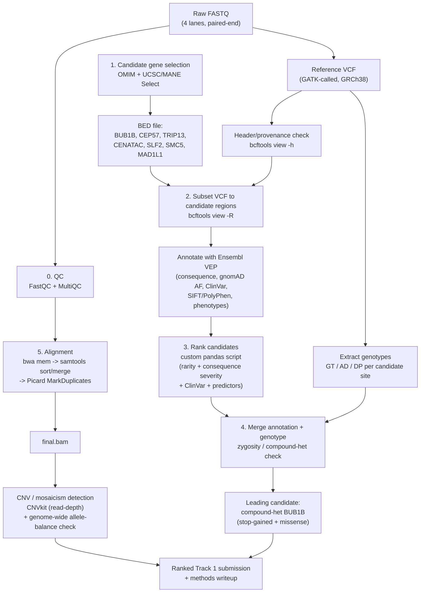

# MVA Hackathon — Track 1 Methods Summary

**Subject:** Proband with clinically confirmed features consistent with Mosaic Variegated Aneuploidy (MVA) — rhabdomyosarcoma, nephrocalcinosis, short stature, failure to thrive, prematurity, severe IUGR, and a family history of recurrent miscarriage.

This document summarizes the analysis pipeline to date: what was done, which tools were used, and — more importantly — *why* each step was necessary given the specific biology of MVA.

---

## Pipeline Overview



---

## 0. Quality Control (FastQC / MultiQC)

**What we did:** Ran FastQC on all raw FASTQ lanes, aggregated with MultiQC.

**Why it matters:** Every downstream conclusion depends on the raw sequencing reads being trustworthy. FastQC checks basic signal quality — per-base quality scores, adapter contamination, duplication rates, GC content. If the raw reads were poor quality, any variant we later call — including a "compound heterozygous BUB1B hit" — could just as easily be a sequencing artifact as a real biological finding. This step doesn't find the disease-causing variant itself; it establishes whether we can trust anything found afterward. MultiQC simply aggregates FastQC's per-lane reports into one readable summary instead of four separate ones.

We also inspected the existing VCF header directly (`bcftools view -h`) before trusting it, to confirm the reference genome build (GRCh38, no `chr` prefix) and the variant caller used (GATK HaplotypeCaller → VariantFiltration with standard hard filters). This matters because different reference builds use incompatible coordinate systems — a gene at position 40,209,701 on one build can be an entirely different piece of DNA on another. Getting this wrong silently invalidates every coordinate used afterward.

---

## 1. Candidate Gene Selection and Coordinate Sourcing

**Biological motivation:** MVA is not caused by any single gene — it is genetically heterogeneous. All currently known causal genes converge on one biological process: the **mitotic spindle assembly checkpoint**, the cell's internal quality-control system that halts division if chromosomes aren't correctly attached before separating. When this checkpoint fails, cells can divide with the wrong number of chromosomes — which is the literal definition of aneuploidy, and "mosaic" because only some of the resulting cells are affected, not all of them.

We identified the seven genes with confirmed OMIM entries for MVA subtypes:

| Gene | MVA Subtype | OMIM |
|---|---|---|
| BUB1B | MVA1 | 257300 |
| CEP57 | MVA2 | 614114 |
| TRIP13 | MVA3 | 617598 |
| CENATAC | MVA4 | 620153 |
| SLF2 | MVA5 | 620184 |
| SMC5 | MVA6 | 620185 |
| MAD1L1 | MVA7 | 620189 |

We deliberately excluded genes that are only *mechanistically adjacent* (e.g., PLK4, CEP63 — centrosome-duplication genes that physically interact with CEP57 but cause a distinct, separately diagnosed condition, primary microcephaly/Seckel syndrome, not MVA) to avoid diluting the candidate list with genes that have no direct disease link.

**Why coordinate sourcing mattered:** Gene coordinates are not a single universally agreed-upon number — different databases (HGNC, RefSeq, Ensembl) sometimes report slightly different start/end positions for the same gene, usually because they're built around slightly different reference transcripts. We standardized on **MANE Select** coordinates (via the UCSC Genome Browser, Human hg38), which is a joint NCBI/Ensembl effort specifically created to give clinical genomics one canonical, agreed-upon transcript per gene — the closest thing to an industry standard for exactly this kind of work.

---

## 2. Subsetting the VCF and Annotating with VEP

**What we did:** Built a BED file of the 7 candidate gene regions, used `bcftools view -R` to extract only variants overlapping those regions from the full genome-wide VCF, then annotated the subset using Ensembl's Variant Effect Predictor (VEP).

**Why subset first:** The full VCF contains ~5 million variants genome-wide — the overwhelming majority irrelevant to MVA. Subsetting to the 7 candidate genes first is a practical filtering step: it makes annotation fast and keeps the initial analysis focused on the genes with the strongest prior biological justification, before falling back to a genome-wide search if nothing turns up here.

**Why VEP, and why these specific annotations:** A raw variant call (e.g., "position 40,209,701, T→G") tells us nothing on its own. Two questions determine whether it's biologically meaningful:

1. **Does it break the protein?** VEP predicts the functional *consequence* of each variant — whether it changes an amino acid (missense), introduces a premature stop (nonsense/stop-gained), shifts the entire reading frame (frameshift), or disrupts splicing.
2. **Is it rare?** We pulled gnomAD allele frequencies — a database of allele frequencies from roughly 800,000 sequenced humans. A disease this rare cannot be explained by a variant that a meaningful fraction of the general population also carries without being sick.

We also enabled ClinVar-linked phenotype annotation, which flags whether a given variant has already been clinically reported and classified (e.g., "pathogenic," "likely pathogenic") in prior cases — effectively checking whether someone has already done part of this work before us.

---

## 3. Ranking Candidates

**What we did:** Wrote a scoring script that filters VEP output down to variants that are (a) rare, (b) predicted to functionally damage the protein, and (c) located in one of the 7 candidate genes — then ranks survivors by a weighted priority score.

**Consequence severity weighting — the biological logic behind the numbers:**

```python
CONSEQUENCE_RANK = {
    "stop_gained": 5,
    "frameshift_variant": 5,
    "splice_acceptor_variant": 4,
    "splice_donor_variant": 4,
    "start_lost": 4,
    "stop_lost": 4,
    "splice_region_variant": 2,
    "missense_variant": 1,
}
```

This ordering reflects how *completely* each consequence type is expected to disable the gene:

- **Stop-gained and frameshift (score 5, highest):** these typically truncate the protein early, or scramble everything downstream of the mutation. In most cases, the resulting protein is non-functional or the transcript is degraded entirely by the cell's own quality control (nonsense-mediated decay). This is the closest thing to a guaranteed "gene knockout."
- **Splice-site disruptions and start/stop-codon losses (score 4):** these can also eliminate normal protein production (by causing exon skipping or a broken reading frame), but the outcome is somewhat less predictable than a clean truncation — some splice-region changes have only a partial effect.
- **Splice-region variants further from the essential splice site (score 2):** more speculative — these sit near a splice junction but are less certain to disrupt splicing than a direct acceptor/donor change.
- **Missense (score 1, lowest of the "damaging" tier):** changes a single amino acid. The protein is still produced and may still partially or fully function — impact depends heavily on exactly which amino acid and where. This is included because MVA is real and can be caused by missense variants, but it's treated as the weakest evidence tier among "damaging" consequences, since a missense change is inherently more likely to be tolerated than a truncation.

**Rarity threshold and columns:**

```python
GNOMAD_AF_COLUMNS = ["gnomADe_AF", "gnomADg_AF", "AF"]
RARE_AF_THRESHOLD = 0.01
```

We take the *maximum* allele frequency across gnomAD exomes, gnomAD genomes, and 1000 Genomes — i.e., the most conservative (least favorable) frequency estimate available for each variant, rather than picking whichever database happens to report the lowest number. A threshold of 1% is a standard, widely used cutoff in rare disease genetics: a variant carried by more than 1 in 100 people in the general population is not a plausible cause of a disease this rare, regardless of what it does to the protein.

**Additional scoring inputs**, each added on top of the base consequence/rarity filter:
- **ClinVar "pathogenic" flag (+100):** if a variant has already been independently classified as disease-causing by prior clinical labs, that is stronger evidence than anything we can infer computationally — weighted accordingly as the dominant factor.
- **Known MVA-relevant phenotype text match (+50):** VEP's phenotype annotations sometimes cite prior literature/case reports tying a specific variant to a specific condition. A direct textual match to "aneuploidy," "MVA," or the gene names themselves is a meaningful independent corroboration.
- **SIFT/PolyPhen "damaging" prediction (+15):** these are two independent computational algorithms that predict whether a missense change is likely to disrupt protein structure/function, based on evolutionary conservation and biophysical modeling. Agreement between these tools and our own filtering adds modest additional confidence, weighted lower than direct clinical evidence.
- **Rarity as a fine-grained tiebreaker (+5 × (1 − AF)):** among variants that already pass the rarity threshold, the very rarest ones get a small additional boost, since "never seen in gnomAD at all" is modestly stronger evidence than "just barely under 1%."

---

## 4. Merging Annotation with Genotype Data (GT / AD / DP)

**Why this was necessary:** VEP tells us *what* a variant does, but not *how the patient actually carries it*. We re-joined each ranked candidate back to its genotype call (GT), allele depth (AD — the number of reads supporting the reference vs. alternate allele), and total read depth (DP) from the original VCF.

**Why zygosity matters specifically for this family:** The family history of recurrent miscarriage is a classic signature of **autosomal recessive** inheritance — both parents are asymptomatic carriers of one damaged copy each, and a child who inherits the damaged copy from *both* parents is affected (and, in a fraction of pregnancies, non-viable). This means a single heterozygous "carrier" variant in the child is not, by itself, expected to explain the disease. We were specifically looking for either:
- A single **homozygous** damaging variant (both copies of the gene broken by the same change), or
- **Two different heterozygous** damaging variants in the same gene (compound heterozygous — one broken copy inherited from each parent).

**Current leading finding:** Two heterozygous variants in **BUB1B** (MVA1), roughly 11kb apart:
- A stop-gained variant (15:40209701 T>G) already classified pathogenic/likely pathogenic in ClinVar, specifically annotated for BUB1B-related MVA.
- A rare (absent from gnomAD), SIFT-predicted-deleterious missense variant (15:40220612 T>G), not previously reported.

This is consistent with a compound heterozygous mechanism. **Important limitation:** with proband-only short-read data, standard read-based phasing cannot confirm the two variants sit on *opposite* chromosome copies (the two positions are too far apart — roughly 11,000 bp — for any single sequencing fragment to span both). Confirming this would require parental sequencing or long-read/linked-read data. This is stated explicitly rather than assumed.

---

## 5. Current Step: Structural Variant / Mosaicism / CNV Detection

**Why this step exists — and why it matters more than it might first appear:** Every step so far (VCF → VEP → ranking → genotype merge) was built entirely on single-nucleotide and small indel variants. This kind of analysis can identify a broken *gene* — but it structurally cannot detect the thing that actually defines MVA as a disease: cells carrying the **wrong number of whole chromosomes**.

The connection is mechanistic, not incidental. BUB1B, CEP57, TRIP13, and the other MVA genes all function in the spindle-assembly checkpoint — the mechanism that checks each chromosome is properly attached to the mitotic spindle before a cell is allowed to divide. When that checkpoint is broken, some daughter cells end up with an extra or missing chromosome after division. Over many cell divisions, this produces a **mosaic** population — some cells euploid (normal), others aneuploid (abnormal count) — which is exactly what "mosaic variegated aneuploidy" describes in its name.

A standard SNV-focused variant caller has no way to see this. It is built to detect single-letter or small-scale changes in DNA sequence, not to count how many copies of an entire chromosome are present in a cell population. Finding a damaged BUB1B gene is strong indirect evidence of *why* the checkpoint might fail — but it does not, by itself, demonstrate that the *downstream consequence* (actual mosaic aneuploidy in the child's cells) is present. Demonstrating that consequence directly, from the same sequencing data, requires a fundamentally different kind of analysis:

- **Read-depth-based copy number detection (e.g., CNVkit):** if a chromosome (or arm, or region) is present at the wrong copy number in a meaningful fraction of the sampled cells, the average sequencing depth across that region will be subtly shifted relative to the rest of the genome — higher for a gain, lower for a loss. Because mosaicism means only some cells are affected, this shift is expected to be smaller and noisier than a clean whole-organism trisomy, which is part of why it requires a dedicated tool rather than a simple visual check.
- **Allele-balance analysis at heterozygous sites:** in a normal diploid cell, a heterozygous site should show roughly a 50/50 read split between the two alleles. If a meaningful fraction of a patient's cells carry three copies of that chromosome instead of two, the genome-wide *average* allele balance at heterozygous sites on that chromosome will skew away from 50/50 (e.g., clustering closer to 33/67), because the extra copy shifts the mixture. This is a second, independent line of evidence for mosaicism that doesn't rely solely on raw read depth.

This step requires aligning the raw FASTQ reads to the reference genome (producing a BAM file) — not just relying on the pre-existing VCF — since copy number and allele-balance signals are computed directly from aligned read depth, information that is not preserved in a standard small-variant VCF.

**Why this closes the loop on the submission, not just adds to it:** Without this step, the analysis identifies a strong genetic *cause* (damaged BUB1B) but leaves the disease's defining biological *signature* (mosaic aneuploidy) unverified from this patient's own data. Completing it means the final submission can report not just "here is a gene that plausibly explains the mechanism" but, ideally, direct evidence that the mechanism is actually manifesting as aneuploidy in this specific child — a substantially stronger and more complete case.

---

## Summary Table

| Step | Tool(s) | Purpose |
|---|---|---|
| 0. QC | FastQC, MultiQC, bcftools | Confirm raw data and existing VCF are trustworthy before building anything on top of them |
| 1. Candidate genes | OMIM, UCSC/MANE Select | Identify all confirmed MVA genes and their precise, standardized coordinates |
| 2. Subset + annotate | bcftools, Ensembl VEP | Focus analysis on biologically relevant regions; predict functional impact and population frequency per variant |
| 3. Ranking | Custom Python/pandas script | Prioritize variants that are rare, damaging, and clinically corroborated |
| 4. Genotype merge | bcftools, pandas | Determine zygosity to test compatibility with the family's apparent recessive inheritance pattern |
| 5. CNV/mosaicism (in progress) | bwa, samtools, Picard, CNVkit | Directly test for the chromosome-level aneuploidy that mechanistically defines MVA, which SNV analysis alone cannot detect |

---

## Sources

**Disease / gene-disease associations**
- OMIM — Mosaic Variegated Aneuploidy Syndrome entries: MVA1 (BUB1B, #257300), MVA2 (CEP57, #614114), MVA3 (TRIP13, #617598), MVA4 (CENATAC, #620153), MVA5 (SLF2, #620184), MVA6 (SMC5, #620185), MVA7 (MAD1L1, #620189). https://www.omim.org/
- NCBI Genetic Testing Registry (GTR) — condition and gene-panel cross-reference. https://www.ncbi.nlm.nih.gov/gtr/conditions/C4551972 and https://www.ncbi.nlm.nih.gov/gtr/tests/567860.2
- Orphanet — Mosaic variegated aneuploidy syndrome overview. https://www.orpha.net/

**Gene coordinates**
- UCSC Genome Browser, Human GRCh38/hg38, MANE Select track. https://genome.ucsc.edu/cgi-bin/hgSearch
- MANE (Matched Annotation from NCBI and EMBL-EBI) — joint RefSeq/Ensembl canonical transcript project. https://www.ncbi.nlm.nih.gov/refseq/MANE/

**Population frequency / clinical significance**
- gnomAD (Genome Aggregation Database) v4 — exome and genome allele frequencies. https://gnomad.broadinstitute.org/
- ClinVar — variant clinical significance classifications. https://www.ncbi.nlm.nih.gov/clinvar/
- 1000 Genomes Project — global allele frequency reference. https://www.internationalgenome.org/

**Reference genome**
- Ensembl GRCh38 primary assembly FASTA (release 110). http://ftp.ensembl.org/pub/release-110/fasta/homo_sapiens/dna/

**Tools**
- FastQC — read quality control. https://www.bioinformatics.babraham.ac.uk/projects/fastqc/
- MultiQC — QC report aggregation. https://multiqc.info/
- bcftools / samtools (htslib) — VCF/BAM manipulation. https://www.htslib.org/
- BWA (bwa-mem) — short-read alignment. https://github.com/lh3/bwa
- Picard (MarkDuplicates, CreateSequenceDictionary) — BAM processing. https://broadinstitute.github.io/picard/
- GATK (HaplotypeCaller, VariantFiltration) — original variant calling pipeline (as recorded in the provided VCF header). https://gatk.broadinstitute.org/
- Ensembl VEP (Variant Effect Predictor) — functional annotation. https://www.ensembl.org/Tools/VEP
- CNVkit — read-depth-based copy number / mosaicism detection. https://cnvkit.readthedocs.io/