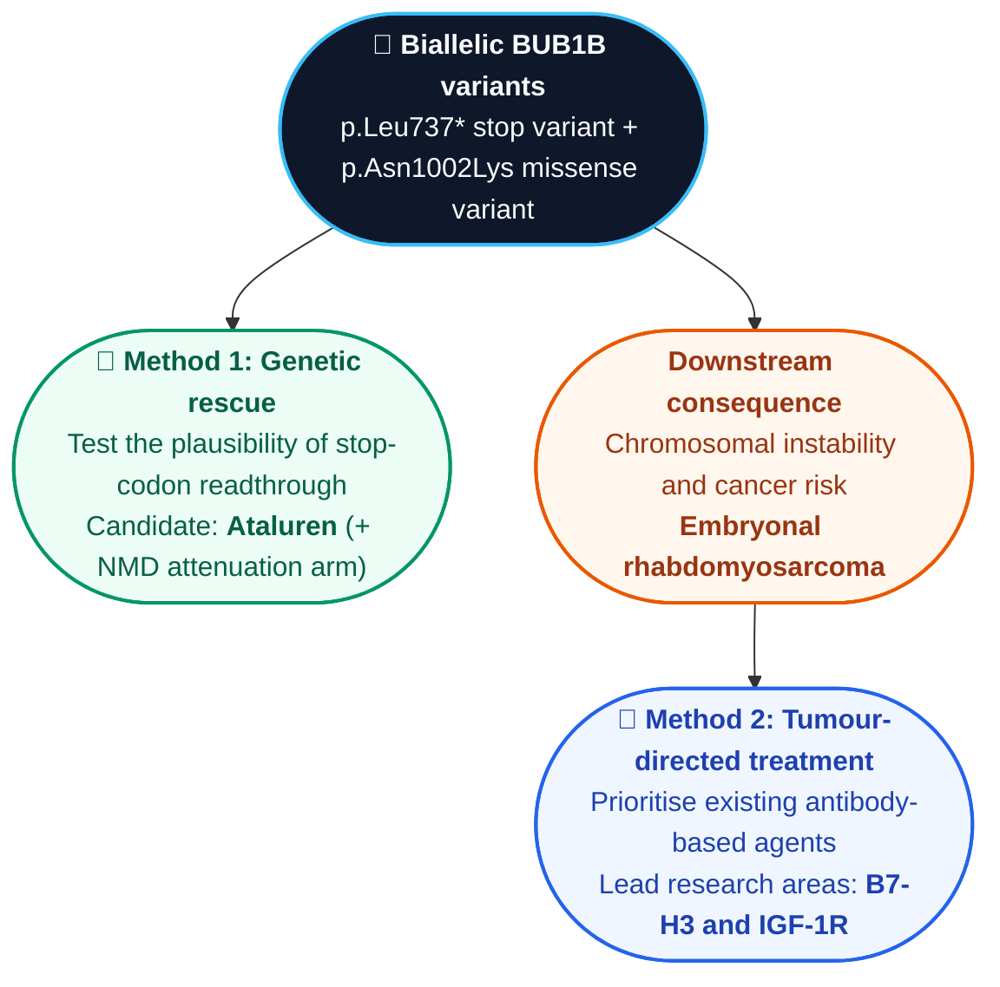
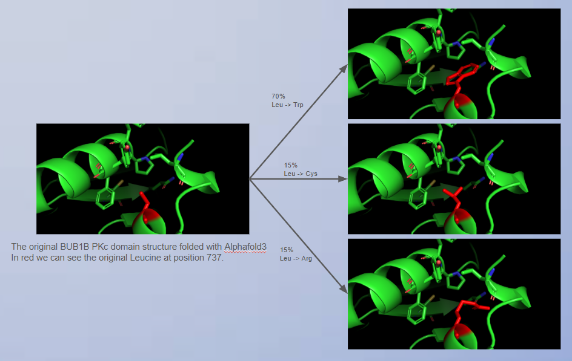
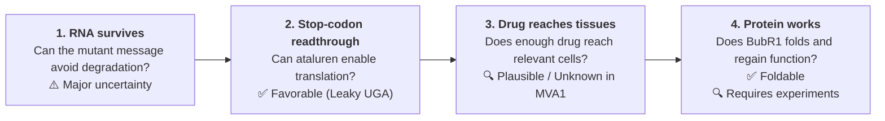
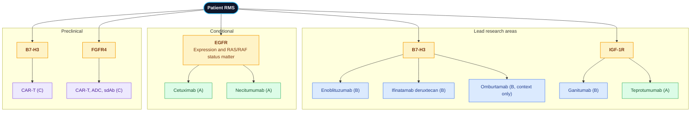

# Methods Description & Report — Track 2 (Drug Repurposing)

**Participant:** Antoine Cadiou ([@antocad3](https://huggingface.co/antocad3)) — Individual Participant  
**Track:** Track 2 — Drug Repurposing (therapeutic hypotheses for follow-up)  
**Report file:** `antocad3_track2_report.md`  
**Disease model:** Mosaic Variegated Aneuploidy Syndrome 1 (MVA1; OMIM #257300)  
**Primary target:** *BUB1B* (BubR1), compound heterozygous genotype from Track 1:

- **Allele 1:** `chr15:40209701 T>G` (c.2210T>G, p.Leu737\*; UGA stop-gained, exon 17 of 23)
- **Allele 2:** `chr15:40220612 T>G` (c.3006T>G, p.Asn1002Lys; missense, exon 23, C-terminal kinase-like domain)

**Reference genome build:** GRCh38 / hg38

> **Nature of this submission.** Everything below is a *hypothesis for follow-up*, not evidence that any medicine works for this child. Treatment decisions belong to the treating clinical team.

This file answers the Track 2 methods description form in the form's question order (`methods_description_form.xlsx`). **The answer to Question 2 is the full report**; Questions 3–11 follow it, and the reference list is at the end.

---

### Question 1: Team Name
**Antoine Cadiou** (Individual Participant | Hugging Face: [@antocad3](https://huggingface.co/antocad3))

---

### Question 2: Detailed Description of the Approach (from variant/mechanism to candidate medication)

*The answer to this question is the full Track 2 report below (Sections 1–6). References are numbered by topic and listed at the end of this file.*

#### Executive summary

This report explores two complementary therapeutic directions for a child with *BUB1B*-related MVA1 and embryonal rhabdomyosarcoma (RMS).

- **Method 1 — Genetic rescue:** investigate whether ataluren could help cells read through a premature stop signal and produce a more complete BubR1 protein, and what would have to be true about mRNA survival for that to matter.
- **Method 2 — Tumour-directed treatment:** compare existing antibody-based agents to identify which targets and treatments merit further investigation for RMS.

The first method addresses the underlying genetic defect; the second addresses the established cancer. They are complementary, because restoring some BubR1 function would not necessarily reverse changes already present in malignant cells.

**Important:** these are research hypotheses, not treatment recommendations. The work combines computational protein modelling and literature-based prioritisation. Neither approach has been shown to work for this patient, and laboratory validation plus review by the treating clinical team would be required.

#### 1. The biological problem: one genetic disorder, two needs

This report explores two complementary therapeutic directions for a child with *BUB1B*-related MVA1 and embryonal rhabdomyosarcoma (RMS).

- **Method 1 — Genetic rescue:** investigate whether ataluren could help cells read through a premature stop signal and produce a more complete BubR1 protein.
- **Method 2 — Tumour-directed treatment:** compare existing antibody-based agents to identify which targets and treatments merit further investigation for RMS.

Together, the variants are consistent with a major loss of BubR1 function. Disrupted chromosome segregation can cause chromosomal instability, a key feature of MVA1 and a contributor to cancer predisposition [1]. 

This motivates two questions:

1. Could the effect of the premature stop variant be partly rescued?
2. Which existing treatments might be worth investigating against the established RMS tumour?

#### 2. Method 1 — Investigating genetic rescue with ataluren

##### 2.1 Rationale

Ataluren (PTC124) was developed to encourage ribosomes to read through certain premature stop codons during protein production [3]. In principle, this could allow some cells carrying the *BUB1B* p.Leu737\* variant to produce a full-length BubR1 protein.

The variant creates a **UGA stop codon**. When ataluren promotes readthrough at UGA, a near-cognate tRNA inserts **tryptophan, arginine or cysteine** at that position, so any resulting protein would not be identical to normal BubR1 (which has leucine at residue 737) [4].

Ataluren previously held conditional EU authorisation for nonsense-mutation Duchenne muscular dystrophy. The authorisation was not renewed in 2025 because its effectiveness had not been confirmed [8]. It is not an established treatment for MVA1, and its potential use here remains speculative.

##### 2.2 Computational structural assessment

We used PyRosetta with the `ref2015` energy function [14] to assess whether the amino acids potentially inserted at position 737 could be accommodated by the local protein structure. The model relaxed the structure within a 15 Å neighbourhood around the mutation, allowing nearby atoms and residues to adjust.

**Results from the structural modelling**

| Modelled state at residue 737 | Unrelaxed energy (REU) | Relaxed energy (REU) | ΔΔG vs. native (REU) | Interpretation |
|---|---:|---:|---:|---|
| Native Leu737 | -105.22 | -191.23 | **0.00** | Wild-type reference |
| Trp737 | +219.18 | -194.80 | **-3.57** | Initial steric clash is relieved after local relaxation |
| Cys737 | -106.79 | -192.04 | **-0.81** | Accommodated in the relaxed model |
| Arg737 | -106.66 | -190.52 | **+0.71** | Small predicted energy difference from the reference |

A negative ΔΔG here means "no energetic penalty detected in this protocol". It should not be read as evidence that the substituted protein is *more* stable than wild type.

This is a **structural plausibility result**, not proof that the rescued protein folds correctly in cells, retains function, or restores the spindle assembly checkpoint. Rosetta energy scores are model-dependent and should not be interpreted as direct experimental measurements of free energy [14].

##### 2.3 Why NMD matters: the 50–55 nucleotide rule and the case for an NMD inhibitor

**Applying it to p.Leu737\*.** The *BUB1B* coding sequence is split over 23 exons. The premature UGA is in **exon 17**, so six exon–exon junctions lie downstream. The last junction is therefore separated from the stop codon by the end of exon 17 and five complete exons (18–22), a distance far greater than 50–55 nt, as established by Nagy and Maquat [9].

**Why this matters for ataluren.** Ataluren acts on translation of the mRNA that is present; it has no apparent effect on mRNA stability [4]. If most Allele 1 transcripts are degraded, the pool of template available for readthrough is small, and even efficient readthrough would yield little full-length protein. That is the rationale for pairing readthrough with partial **NMD attenuation**, which has been shown to enhance nonsense suppression in a mouse model of a different disease [10].

**Candidate NMD-attenuation tools (research tools, not therapies).**

- **SMG1 kinase inhibition.** SMG1 phosphorylates UPF1, a step required for NMD [10]. Pyrimidine-based hSMG-1 inhibitors (e.g. compound 11j) are available as laboratory tool compounds [11].
- **Antisense oligonucleotides** that block exon-junction-complex deposition near a specific exon–exon junction, which can reduce NMD of a chosen transcript more selectively than global inhibition [12].

**Safety caveats.** NMD has physiological roles, and the safety of global long-term NMD inhibition is unclear: in a regulated mouse model, modest NMD inhibition was tolerated in most non-neurological tissues while stronger inhibition was not [13]. SMG1 inhibitors have also been developed as anticancer tool compounds and reduce proliferation of cancer cell lines [11]. The proposal is therefore limited to **experiments in patient-derived cells**, and it does not suggest giving an NMD inhibitor to the patient.

##### 2.4 The key steps between a variant and a therapeutic effect

Even if the local structure can accommodate a substituted amino acid, several additional steps must succeed before genetic rescue could help the patient.

The most important caveats are:

- **RNA degradation:** premature stop variants can trigger NMD, reducing the amount of RNA available for readthrough [9]. Section 2.3 applies the rule to this variant and explains why it justifies an NMD-attenuation arm.
- **Readthrough activity:** the UGA stop signal provides a mechanistic rationale, but it does not establish that ataluren will produce useful levels of full-length BubR1.
- **Protein function:** the structural model tests local accommodation, not whether the full protein folds and functions correctly.
- **Tissue exposure:** oral ataluren has been characterised for safety and pharmacokinetics in healthy adult volunteers [7]; exposure and effects in the tissues relevant to MVA1 have not been established.

**Method 1 conclusion:** the computational result supports further investigation of the structural feasibility of readthrough, but the 50–55 nt rule predicts that mRNA survival is the main bottleneck. It does not establish ataluren efficacy.

#### 3. Method 2 — Prioritising existing antibody-based treatments for RMS

##### 3.1 Why focus on the tumour directly?

Genetic rescue, even if successful, would not be expected to reverse all chromosome abnormalities already present in malignant cells. The established tumour therefore needs to be considered separately.

We chose to prioritise existing antibody-based agents rather than design a new antibody. For this question, identifying which known agents deserve follow-up is more decision-relevant than pursuing a predicted improvement in binding without experimental validation.

The workflow has three stages: assess evidence, check tumour and normal-tissue expression, and consider patient-specific factors. The first stage was completed; expression and safety screening was specified but **not executed** in this report.

##### 3.2 Evidence tiers

| Tier | Meaning |
|:---:|---|
| **A** | Approved for another condition; possible repurposing candidate |
| **B** | Investigational agent with relevant clinical experience |
| **C** | Preclinical approach, not established in patients |

"Approved" means approved for another indication, not approved for RMS. A higher tier does not automatically mean a treatment is more effective for this patient.

##### 3.3 Candidate comparison

The initial review identified **B7-H3 and IGF-1R as co-leading research areas**, but for different reasons. B7-H3 has broad reported expression in RMS and multiple treatment approaches under investigation, although the first paediatric antibody trial reported no objective responses. IGF-1R has a clearer history of clinical testing in RMS, although responses have generally been limited or temporary [19, 21, 22].

| Initial priority | Agent or approach | Target | Tier | Main reason for inclusion and key evidence |
|---|---|---|:---:|---|
| Lead | Ganitumab | IGF-1R | B | Most pediatric RMS highly express IGF-1R, and single-agent anti-IGF-1R antibodies gave clinically meaningful responses in about 10–15% of RMS patients, but almost all were short-lived [19]. A phase I trial of ganitumab plus dasatinib found the combination safe and tolerable (one confirmed partial response among nine response-evaluable patients); the phase II part closed because ganitumab became unavailable [19]. Preclinically, ganitumab plus the MEK inhibitor trametinib inhibited tumour growth in 4 of 6 RAS-mutant RMS models [20]. |
| Lead | Teprotumumab | IGF-1R | A | Same target and rationale as ganitumab. It is the only IGF-1R antibody here that is *already approved* (thyroid eye disease), which makes it the true repurposing candidate. *No RMS-specific evidence identified.* Its epitope and pharmacology are not assumed equivalent to ganitumab, and its US label carries warnings including hyperglycaemia and hearing impairment [28]. |
| Lead | Enoblituzumab | B7-H3 | B | B7-H3 staining was reported in 95% of rhabdomyosarcoma tumours in one study [21]. In the paediatric phase I trial (25 patients with B7-H3-expressing relapsed or refractory solid tumours), weekly dosing was feasible, but **no objective tumour responses** were observed [22]. |
| Lead | Ifinatamab deruxtecan | B7-H3 | B | B7-H3-directed antibody–drug conjugate. The US application for small cell lung cancer was accepted with Priority Review in April 2026 [26] and then **voluntarily withdrawn by the sponsors in September 2026** [27], so it remains investigational. No RMS data identified. |
| Conditional | Cetuximab | EGFR | A | EGFR is highly expressed in embryonal RMS, at higher levels than in normal muscle [17]. In RMS cell lines, cetuximab alone had only a slight effect but enhanced actinomycin D cytotoxicity in EGFR-amplified lines [18]. RAS/RAF mutations occur in about 27% of ERMS in one institutional series [16]; by analogy with colorectal cancer, a RAS-mutant tumour may resist anti-EGFR antibodies (an inference, not shown in RMS). Approved elsewhere (colorectal, head and neck); preclinical only in RMS. |
| Conditional | Necitumumab | EGFR | A | Same rationale and RAS caveat as cetuximab. Approved elsewhere (lung). No RMS-specific data found. |
| Early-stage | B7-H3 CAR-T | B7-H3 | C | CD276-directed CAR T cells eradicated RD- and Rh4-derived RMS tumours in orthotopic mouse models [23]. Preclinical in RMS. |
| Early-stage | FGFR4 CAR-T, ADC or single-domain antibody | FGFR4 | C | FGFR4 was confirmed as an RMS surface target by surfaceome profiling [24]; FGFR4 single-domain antibodies blocked FGFR4 signalling and supported cytotoxic CAR T cells and targeted liposomes in vitro [25]; dual CD276/FGFR4 CAR T cells cleared Rh4 tumours in mice [23]. |
| Context only | Omburtamab | B7-H3 | B | Same target as enoblituzumab. A radiolabelled antibody developed mainly for neuroblastoma; limited relevance to RMS. |

**How to interpret the leading targets**

- **B7-H3:** promising as a research target because expression has been reported in many RMS tumours and several treatment formats are being explored [21, 23]. Clinical benefit in RMS remains unproven, and the one paediatric antibody trial reported no objective responses [22]. The status of the ADC changed during this audit [26, 27].
- **IGF-1R:** has clinical experience in RMS, but single-agent responses have often been transient. Resistance and combination strategies remain important issues, as does drug supply: the phase II ganitumab–dasatinib study could not be completed because ganitumab became unavailable [19, 20].
- **EGFR:** a conditional option. The tumour would need to express EGFR, and RAS/RAF status could affect the rationale. The cited evidence is stronger for possible sensitisation to chemotherapy in laboratory models than for stand-alone use [16–18]. RMS genomes frequently carry alterations along a receptor tyrosine kinase/RAS axis, which is why RAS status matters [15].
- **FGFR4:** biologically interesting but still at the preclinical stage [23–25].

The following map summarises how the candidates relate to the tumour targets and evidence tiers.

##### 3.4 What is still needed for this patient?

The candidate ranking is not patient-specific yet. Before any treatment could be meaningfully considered, the following information would be important:

- **Tumour target expression:** confirm whether B7-H3, IGF-1R, EGFR and FGFR4 are present on this child's tumour cells.
- **Tumour genomics:** determine RAS/RAF status, particularly if considering an EGFR-directed approach.

**Method 2 conclusion:** B7-H3 and IGF-1R are the leading areas for further research, with EGFR as a conditional option and FGFR4 as an early-stage possibility. This ranking could change after tumour profiling and safety review.

#### 6. Limitations

- No experiments were performed on the patient's cells or tumour as part of this analysis.
- The Method 1 energy metrics are computational outputs and do not demonstrate protein activity or clinical benefit. The result depends on the assumed amino-acid mix (Section 2.2).
- NMD of the Allele 1 transcript is predicted from the 50–55 nt rule, not measured [9].
- The two *BUB1B* alleles are unphased; if they were in *cis*, the genotype and the logic of rescue would change.
- The patient's tumour-expression and genomic data were unavailable, so Method 2's ranking is conditional.
- The planned normal-tissue expression and safety screening was not executed.
- Several candidate agents have only preclinical or early clinical evidence.
- Drug-development and regulatory statuses can change. They were checked on 24 October 2026 and should be re-verified before presentation.
- This report is not clinical advice. Treatment decisions belong to the treating clinical team.

---

### Question 3: Generative AI / AI Assistant Disclosure
* **Tool:** Anthropic Claude (claude.ai web chat, Sonnet) and Google DeepMind Antigravity IDE.
* **Usage:** learning about the field (MVA, readthrough, NMD), literature triage, script optimisation, documentation structuring.
* **Data privacy:** no raw patient genomic data (FASTQ/VCF) was shared with any cloud LLM. Only the two variant annotations that appear in this report (gene, coordinates, HGVS protein change) and the clinical phenotype summary were included in prompts.

---

### Question 4: Candidate Identification — Automated or Manual?
**Primarily manual literature review and expert curation.**
However, the entire results from section 2.2 are automated and reproductible with a python script provided in the github.
---

### Question 5: Manual Literature Review and Curation in Detail
* **Candidate pool (Method 2):** nine antibody-based agents or approaches targeting B7-H3, IGF-1R, EGFR and FGFR4, chosen because each target has RMS-specific expression or functional evidence in the literature [17, 19, 21, 24].
* **Tiering:** each agent was assigned to tier A, B or C using regulator records, trial publications and preclinical papers (Section 3.2). "Approved" always means approved for *another* indication.
* **Targets considered and dropped from the final table:** bevacizumab (VEGF-A), trastuzumab (HER2) and a ROR1-directed agent were reviewed in an earlier draft and removed to keep the table focused; they are not part of the ranking.
* **Status audit (24 October 2026):** regulatory and trial status of each agent was re-checked. Findings that changed the text: the US application for ifinatamab deruxtecan was voluntarily withdrawn [26, 27]; the enoblituzumab paediatric phase I trial has now been published, with no objective responses [22]; the EU authorisation of ataluren expired after non-renewal [8].
* **Method 1 curation:** readthrough amino-acid frequencies were taken from the primary measurement paper [4] rather than from review summaries; the NMD rule was taken from its original description [9].

---

### Question 6: Public vs. Proprietary Data
Our approach relied **solely on publicly available drug/target information and literature**.

---

### Question 7: Public Data Sources in Detail
1. **Protein structure input for PyRosetta:** I downloaded the FASTA file from https://www.uniprot.org/uniprotkb/O60566/entry, and then used AlphaFold server to fold the protein; energy function `ref2015` [14].

---

### Question 8: Proprietary Data Sources
None.

---

### Question 9: How the Variant Mechanism Was Characterised

* **Loss of function, not gain of function.** p.Leu737\* introduces a premature UGA stop in exon 17 of 23, upstream of the C-terminal kinase-like domain. By the 50–55 nt rule [9] it is predicted to trigger NMD (Section 2.4), so it behaves as a null allele. 
* **Pathway disrupted.** *BUB1B* encodes BubR1, a core spindle assembly checkpoint protein. Biallelic *BUB1B* defects cause constitutional aneuploidy and cancer predisposition [1]; this is the downstream consequence we link to the child's RMS.

---

### Question 10: Time / Effort Spent
For the track1: I spent really a lot of time because it was slightly outside my range of knowledge and I had a lot to catch up with (maybe a week, more than 40 hours).
For the track2, I spent around the same amount of time. I initially started a completely different approach after the method2: I wanted to start from an existing structure of an antigen-antibody; then I wanted to extract only the CDRs in contact with the epitope and perform an MSA (Multi sequence alignment) followed by a clustering (maybe using Foldseek), to find homolog Ligands/small molecules that already exists, are approved, and could bind to the epitope as well. Then I would have done MD simulations. 
But I decided not to continue in this direction because I already spent a lot of time for the project and I didn't have the computational ressources to run such algorithms in a short time.
I encourage you to explore that eventually.

---

### Question 11: Method Abstract (≤ 500 words)

> Mosaic variegated aneuploidy 1 (MVA1) in this proband is explained by two *BUB1B* variants identified in Track 1: a stop-gained allele (c.2210T>G, p.Leu737\*, exon 17 of 23) and a missense allele (c.3006T>G, p.Asn1002Lys, exon 23) in the C-terminal kinase-like domain of BubR1, a core spindle assembly checkpoint protein [1, 2]. We characterised the mechanism as loss of function, with chromosomal instability as the downstream consequence and the child's rhabdomyosarcoma (RMS) as its established malignant outcome [1]. This gives two complementary, hypothesis-generating strategies; neither is a treatment recommendation.
>
> **Method 1 (genetic rescue)** asks whether ataluren-driven stop-codon readthrough could restore full-length BubR1 from the p.Leu737\* allele. The stop is UGA, where readthrough inserts Trp, Arg or Cys [4]. Using PyRosetta (`ref2015`), we relaxed a 15 Å neighbourhood around residue 737 for each substitution; none showed an energetic barrier after relaxation (ΔΔG −3.57, −0.81 and +0.71 REU for Trp, Cys and Arg). The weighted ensemble value depends on the assumed amino-acid mix: −2.51 REU for an illustrative 70/15/15 mix, −0.54 REU with the frequencies measured in human cells, and −3.12 REU with yeast frequencies [4]. We then applied the 50–55 nucleotide rule [9]: the premature stop lies in exon 17 with six downstream exon–exon junctions, so the transcript is predicted to be an NMD substrate, which would limit the template available for readthrough. We therefore propose testing ataluren together with NMD attenuation (SMG1 inhibition or antisense blocking of exon-junction-complex deposition [10–12]) in patient-derived cells, starting with allele-specific RNA measurement.
>
> **Method 2 (tumour-directed)** is a manual, evidence-graded prioritisation of nine existing antibody-based agents or approaches against RMS, using three tiers (approved elsewhere, investigational with clinical experience, preclinical). B7-H3 (enoblituzumab, ifinatamab deruxtecan, CAR-T) and IGF-1R (ganitumab, teprotumumab) emerged as co-leading axes; EGFR (cetuximab, necitumumab) is conditional on RAS status and EGFR expression; FGFR4 is preclinical. A status audit on 24 October 2026 corrected two items: the US application for ifinatamab deruxtecan was withdrawn [27], and the enoblituzumab paediatric phase I reported no objective responses [22].
>
> **Strengths.** Mechanism-first logic linking variant, codon, rescue chemistry and RNA fate; explicit assumptions with a sensitivity analysis; only public sources; a workflow that can be reused for any nonsense variant and any tumour type.
>
> **Limitations.** No wet-lab data. Rosetta energies are model-dependent and local to a 15 Å neighbourhood. The amino-acid mix is assumed, and human-cell measurements favour Arg over Trp [4]. NMD extent is predicted, not measured. The alleles are unphased. Ataluren lost its EU authorisation in 2025 [8] and its cellular activity has been contested [5, 6]. Tumour expression and genomics were unavailable, and the expression/safety gate for Method 2 was specified but not executed.

---

---

## References

*Numbered by topic. Every number is cited at least once in this file.*

**BUB1B / MVA**

1. Hanks S, et al. (2004). Constitutional aneuploidy and cancer predisposition caused by biallelic mutations in *BUB1B*. *Nat Genet*, 36(11):1159–1161.
2. Suijkerbuijk SJE, et al. (2012). The vertebrate mitotic checkpoint protein BUBR1 is an unusual pseudokinase. *Dev Cell*, 22(6):1321–1329. doi:10.1016/j.devcel.2012.03.009.
3. Welch EM, et al. (2007). PTC124 targets genetic disorders caused by nonsense mutations. *Nature*, 447(7140):87–91.
4. Roy B, Friesen WJ, Tomizawa Y, et al. (2016). Ataluren stimulates ribosomal selection of near-cognate tRNAs to promote nonsense suppression. *Proc Natl Acad Sci USA*, 113(44):12508–12513. doi:10.1073/pnas.1605336113.
5. Auld DS, Thorne N, Maguire WF, Inglese J. (2009). Mechanism of PTC124 activity in cell-based luciferase assays of nonsense codon suppression. *Proc Natl Acad Sci USA*, 106(9):3585–3590.
6. McElroy SP, et al. (2013). A lack of premature termination codon read-through efficacy of PTC124 (ataluren) in a diverse array of reporter assays. *PLoS Biol*, 11(6):e1001593.
7. Hirawat S, et al. (2007). Safety, tolerability, and pharmacokinetics of PTC124, a nonaminoglycoside nonsense mutation suppressor, following single- and multiple-dose administration to healthy male and female adult volunteers. *J Clin Pharmacol*, 47(4):430–444.
8. European Medicines Agency. Translarna (ataluren): European Public Assessment Report; European Commission decision of 28 March 2025 not to renew the conditional marketing authorisation. https://www.ema.europa.eu/en/medicines/human/EPAR/translarna
9. Nagy E, Maquat LE. (1998). A rule for termination-codon position within intron-containing genes: when nonsense affects RNA abundance. *Trends Biochem Sci*, 23(6):198–199.
10. Keeling KM, Wang D, Dai Y, et al. (2013). Attenuation of nonsense-mediated mRNA decay enhances in vivo nonsense suppression. *PLoS One*, 8(4):e60478.
11. Gopalsamy A, Bennett EM, Shi M, Zhang WG, Bard J, Yu K. (2012). Identification of pyrimidine derivatives as hSMG-1 inhibitors. *Bioorg Med Chem Lett*, 22(21):6636–6641. doi:10.1016/j.bmcl.2012.08.107.
12. Nomakuchi TT, Rigo F, Aznarez I, Krainer AR. (2016). Antisense oligonucleotide-directed inhibition of nonsense-mediated mRNA decay. *Nat Biotechnol*, 34(2):164–166. doi:10.1038/nbt.3427.
13. Echols J, Siddiqui A, Dai Y, Havasi V, Sun R, Kaczmarczyk A, Keeling KM. (2020). A regulated NMD mouse model supports NMD inhibition as a viable therapeutic option to treat genetic diseases. *Dis Model Mech*, 13(8).
14. Alford RF, et al. (2017). The Rosetta all-atom energy function for macromolecular modeling and design. *J Chem Theory Comput*, 13(6):3031–3048.
15. Shern JF, et al. (2014). Comprehensive genomic analysis of rhabdomyosarcoma reveals a landscape of alterations affecting a common axis of DNA damage repair and RTK/RAS signaling. *Cancer Discov*, 4(2):216–231.
16. Agaram NP, Huang SC, Tap WD, Wexler LH, Antonescu CR. Clinicopathologic and survival correlates of embryonal rhabdomyosarcoma driven by RAS/RAF mutations. PMC8956004.
17. De Giovanni C, Landuzzi L, Palladini A, Nicoletti G, Nanni P, Lollini PL. (2021). HER tyrosine kinase family and rhabdomyosarcoma: role in onset and targeted therapy. *Cells*, 10(7):1808. doi:10.3390/cells10071808.
18. Yamamoto Y, Fukuda K, Fuchimoto Y, et al. (2013). Cetuximab promotes anticancer drug toxicity in rhabdomyosarcomas with EGFR amplification in vitro. *Oncol Rep*, 30(3):1081–1086. doi:10.3892/or.2013.2588.
19. Akshintala S, et al. (2023). Phase I trial of ganitumab plus dasatinib to cotarget the insulin-like growth factor 1 receptor and Src family kinase YES in rhabdomyosarcoma. *Clin Cancer Res*, 29(17):3329–3339. doi:10.1158/1078-0432.CCR-23-0709.
20. Hebron KE, et al. (2023). The combination of trametinib and ganitumab is effective in RAS-mutated PAX-fusion negative rhabdomyosarcoma models. *Clin Cancer Res*, 29(2):472–487. doi:10.1158/1078-0432.CCR-22-1646.
21. Majzner RG, et al. (2019). CAR T cells targeting B7-H3, a pan-cancer antigen, demonstrate potent preclinical activity against pediatric solid tumors and brain tumors. *Clin Cancer Res*, 25(8):2560–2574.
22. DeSantes KA, et al. A phase I, open-label, dose escalation study of enoblituzumab in children and young adults with B7-H3-expressing relapsed or refractory solid tumors. *Cancer Res Commun* (2025). doi:10.1158/2767-9764.CRC-25-0293 (NCT02982941).
23. CD276-CAR T cells and dual-CAR T cells targeting CD276/FGFR4 promote rhabdomyosarcoma clearance in orthotopic mouse models. (2023). *J Exp Clin Cancer Res*. doi:10.1186/s13046-023-02838-3.
24. Timpanaro A, et al. (2023). Surfaceome profiling of cell lines and patient-derived xenografts confirm FGFR4, NCAM1, CD276, and highlight AGRL2, JAM3, and L1CAM as surface targets for rhabdomyosarcoma. *Int J Mol Sci*, 24(3):2601. doi:10.3390/ijms24032601.
25. Alijaj N, Moutel S, Gouveia ZL, et al. (2020). Novel FGFR4-targeting single-domain antibodies for multiple targeted therapies against rhabdomyosarcoma. *Cancers*, 12(11):3313. doi:10.3390/cancers12113313.
26. Daiichi Sankyo / Merck. Ifinatamab deruxtecan granted Priority Review in the U.S. for adult patients with previously treated extensive-stage small cell lung cancer (press release, 13 April 2026). https://www.merck.com/news/ifinatamab-deruxtecan-granted-priority-review-in-the-u-s-for-adult-patients-with-previously-treated-extensive-stage-small-cell-lung-cancer-who-experienced-disease-progression-on-or-after-platinum-bas/
27. CancerNetwork. FDA discussion prompts voluntary withdrawal of BLA for I-DXd in ES-SCLC (reporting the Merck news release of 25 September 2026). https://www.cancernetwork.com/view/fda-discussion-prompts-voluntary-withdrawal-of-bla-for-i-dxd-in-es-sclc
28. TEPEZZA (teprotumumab-trbw) US prescribing information.
